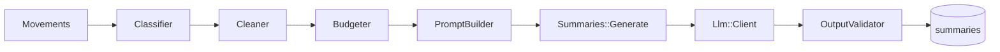

# Design: AI lawsuit summary

## Overview

Pure pipeline (classify -> clean -> budget -> prompt) feeding a provider-agnostic client, wrapped by a caching service and exposed through GraphQL.



## Components

| Component | Location | Notes |
|-----------|----------|-------|
| `Llm::Client` | `app/services/llm/client.rb` | Facade: `Llm::Client.build` reads ENV and returns a provider; `#complete` with retry |
| `Llm::Result` | `app/services/llm/result.rb` | `Struct(text, input_tokens, output_tokens, model)` |
| `Llm::Errors` | `app/services/llm/errors.rb` | `TimeoutError`, `RateLimitError`, `ProviderError` < `Llm::Error` |
| `Llm::Providers::Fake` | `app/services/llm/providers/fake.rb` | Deterministic pt-BR text from the user prompt metadata; can be told to fail in tests |
| `Llm::Providers::Gemini` | `app/services/llm/providers/gemini.rb` | Faraday; endpoint `v1beta/models/{model}:generateContent`; header `x-goog-api-key`; timeout from ENV; maps HTTP/JSON errors; parses `usageMetadata`; see ADR-0002 log |
| `Llm::RetryPolicy` | `app/services/llm/retry_policy.rb` | 2 retries (1 s, 2 s) on timeout/429/500/503, then one fallback-model attempt, total deadline about 45 s; injectable `sleeper`/clock for fast specs |
| `Movements::Classifier` | `app/services/movements/classifier.rb` | Ordered list of `[regex, class]` rules; fold accents/case |
| `Movements::Cleaner` | `app/services/movements/cleaner.rb` | `Teor do ato` extraction, PII/boilerplate removal |
| `Summaries::PromptBuilder` | `app/services/summaries/prompt_builder.rb` | Returns `Prompt(system:, user:, stats:)`; constants `PROMPT_VERSION`, budgets |
| `Summaries::OutputValidator` | `app/services/summaries/output_validator.rb` | Strip, count, truncate, jargon warnings |
| `Summaries::Digest` | `app/services/summaries/digest.rb` | SHA256 of ordered `date|title|content` |
| `Summaries::Generate` | `app/services/summaries/generate.rb` | Cache, advisory lock, provider call, corrective retry, persist |
| `Summary` | `app/models/summary.rb` | Validations; `Summary.current_for(lawsuit)` |
| GraphQL | `types/summary_type.rb`, `mutations/generate_summary.rb`, field `latestSummary` | Thin |
| Rake | `lib/tasks/summaries.rake` | `summaries:eval` |

## Interfaces

```ruby
Llm::Client.build.complete(system: "...", user: "...", max_output_tokens: 700)
# => #<Llm::Result text="..." input_tokens=1234 output_tokens=321 model="...">

Summaries::Generate.call(lawsuit: lawsuit)
# => Result(summary: <Summary>, cache_hit: true/false) | Result(error_code: :summary_unavailable)
```

## Data model

```ruby
create_table :summaries do |t|
  t.references :lawsuit, null: false, foreign_key: true
  t.text    :body, null: false
  t.string  :movements_digest, null: false
  t.string  :prompt_version, null: false
  t.string  :provider, null: false
  t.string  :model, null: false
  t.integer :input_tokens
  t.integer :output_tokens
  t.timestamps
end
add_index :summaries, [:lawsuit_id, :movements_digest, :prompt_version, :model], unique: true, name: "index_summaries_on_cache_key"
```

## Generate algorithm

```
digest = Digest.call(movements)
key = [lawsuit.id, digest, PROMPT_VERSION, model]
hit = Summary.find_by(key) -> return (cache_hit: true)
Summary.transaction do
  advisory_xact_lock(hash(key))
  hit = Summary.find_by(key) -> return           # second waiter
  prompt = PromptBuilder.call(lawsuit, movements)
  result = client.complete(system:, user:, max_output_tokens:)
  text = OutputValidator.call(result.text)
  text needs retry? -> second call with stricter user suffix; validate again; merge/truncate if still long
  Summary.create!(...)
end
rescue Llm::Error -> log, return summary_unavailable (no row)
```

Note: the advisory lock is held for the duration of the provider call, which blocks the second request intentionally. The lock is transaction-scoped, so it is released on commit/rollback; the HTTP call happens inside the transaction by design (simplicity at this scale; see ADR-0003).

## Classifier rules (excerpt)

Rules are an ordered array in one file, each with a comment citing the glossary. First match wins. Table-driven tests load a YAML of `title -> expected_class` taken from real CSV titles (kept small, about 60 titles).

## Prompt constants

`PROMPT_VERSION = "v1"`, `MAX_PROMPT_CHARS = 24_000`, `MAX_MILESTONE_CHARS = 1_200`, `MAX_CONTEXT_CHARS = 300`, `MAX_OUTPUT_TOKENS = 700`, `LAST_N_ALWAYS = 15`, `NOISE_RECENT = 5`. Prompt text files in `app/services/llm/prompts/summary_system_v1.txt` and loaded at boot.

## Error handling

| Failure | Result |
|---------|--------|
| `Llm::TimeoutError`, `RateLimitError`, `ProviderError` after retry | `SUMMARY_UNAVAILABLE`; logged without content |
| Validator rejects blank output | Treated as `ProviderError` |
| Unknown lawsuit / invalid number (mutation) | `NOT_FOUND` / `INVALID_CNJ` |
| DB unique violation (race fallback) | Re-read and return the existing row |

## Testing strategy

- Classifier: YAML table of real titles; first-match order; unknown -> context; `Teor do ato` promotion.
- Cleaner: fixtures from real contents (publication block, lawyer lines, `Teor do ato`).
- PromptBuilder: ordering; metadata; over-budget lawsuit keeps first, last 15, milestones; total length <= budget; no OAB pattern in output (`OAB \d+`); system prompt contains each required instruction; injection fixture stays in the data block.
- Validator: blank, 4+ paragraphs, markdown, too long, jargon warning.
- Gemini adapter (WebMock, hand-written JSON bodies copied from the real response shape): 200 with `STOP`, `MAX_TOKENS`, `SAFETY`, `promptFeedback.blockReason`, 429, 500, 503 then success on retry, 503 on every attempt then fallback model success, timeout, malformed JSON, missing key; assert the request header `x-goog-api-key`, the absence of `key=` in the URL, retry/sleep sequence (fake sleeper), and that logs and exception messages never contain the key.
- Generate: cache hit/miss; digest change; prompt-version bump; failure persists nothing; two threads -> one provider call (use `Thread` + `Fake` call counter).
- GraphQL: `latestSummary` never calls provider (assert counter 0); mutation success/errors.
- `summaries:eval` is excluded; a spec only checks that the task is defined and refuses to run with `fake` unless `ALLOW_FAKE=1`.
