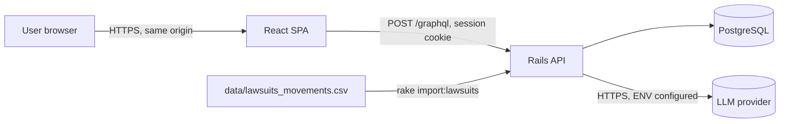
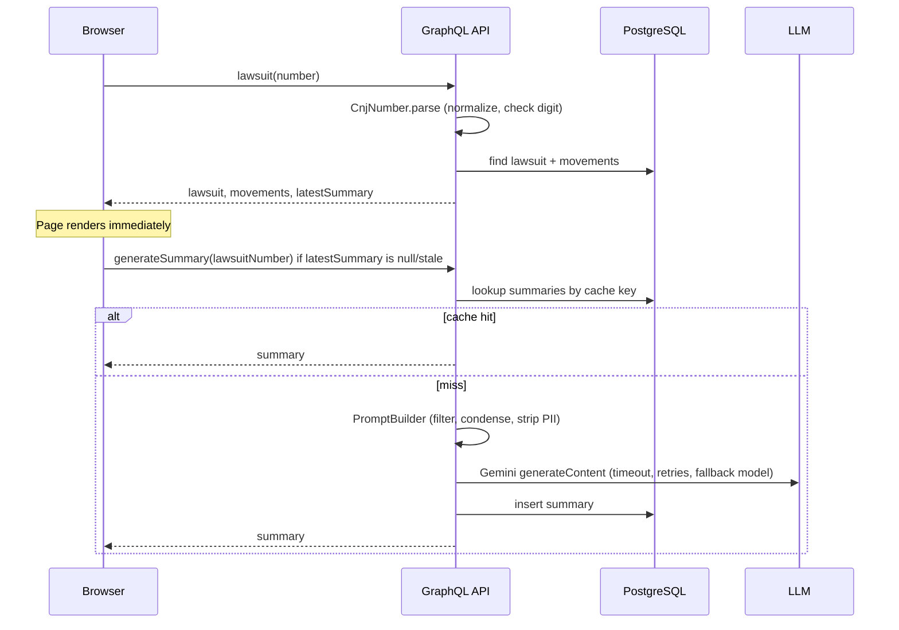

# Architecture

> Target architecture for the lawsuit lookup app. Decisions are recorded in [`docs/adr/`](adr/). Update this file when a boundary, table or GraphQL type changes.

## 1. Context



- The CSV is the only source of lawsuit data. No scraping of esaj.tjsp.jus.br.
- Browser and API share one origin (Vite dev proxy in development, API serves the built SPA or a reverse proxy in production), so cookie auth needs no CORS.
- The LLM is called **only from the backend**. The API key never reaches the browser.

## 2. Backend layers (Rails API)

| Layer | Location | Responsibility |
|-------|----------|----------------|
| GraphQL | `app/graphql/` | Types, queries, mutations. Thin: parse input, call a service, map errors. |
| Services | `app/services/` | Business logic. One public method (`call`) per service. |
| LLM adapters | `app/services/llm/` | `Llm::Client` interface; `Llm::Providers::*` adapters; `Llm::Providers::Fake`. |
| Models | `app/models/` | Persistence, validations, scopes. No external calls. |
| Import | `app/services/imports/` + `lib/tasks/import.rake` | CSV parsing and idempotent load. |
| Support | `app/lib/` (pure Ruby) | `CnjNumber` (parse, format, check digit), `BrlParser` (money/date), `PromptBuilder`. Unit-testable without Rails. |

Rules: controllers/resolvers never contain business rules; models never call the LLM; services never read `params`.

## 3. Data model

```mermaid
erDiagram
    LAWSUITS ||--o{ MOVEMENTS : has
    LAWSUITS ||--o{ SUMMARIES : has
    SUMMARIES ||--o{ SUMMARY_FEEDBACKS : receives
    USERS ||--o{ SUMMARY_FEEDBACKS : gives
    USERS ||--o{ SESSIONS : has

    LAWSUITS {
        bigint id PK
        string number UK "CNJ formatted NNNNNNN-DD.AAAA.J.TR.OOOO"
        string forum
        string court
        decimal value "15,2"
        int number_of_authors
        timestamps
    }
    MOVEMENTS {
        bigint id PK
        bigint lawsuit_id FK
        date occurred_on
        string title
        text content "nullable"
        int source_row "CSV line, tie-breaker"
        timestamps
    }
    SUMMARIES {
        bigint id PK
        bigint lawsuit_id FK
        text body
        string movements_digest "sha256 of ordered movements"
        string prompt_version
        string provider
        string model
        int input_tokens "nullable"
        int output_tokens "nullable"
        timestamps
    }
    USERS {
        bigint id PK
        string email UK
        string password_digest
        timestamps
    }
    SESSIONS {
        bigint id PK
        bigint user_id FK
        string token_digest UK
        string user_agent
        string ip_address
        datetime expires_at
        timestamps
    }
    SUMMARY_FEEDBACKS {
        bigint id PK
        bigint summary_id FK
        bigint user_id FK
        boolean helpful
        timestamps
    }
```

Constraints and indexes:

- `lawsuits.number` unique; stored in formatted form; lookups normalize input first.
- `movements`: index `(lawsuit_id, occurred_on DESC, source_row ASC)`; `source_row` is the 1-based data-row index in the CSV.
- `summaries`: unique `(lawsuit_id, movements_digest, prompt_version, model)` - this is the cache key.
- `summary_feedbacks`: unique `(summary_id, user_id)`; upsert semantics (a user can change the vote).
- `sessions.token_digest` stores a SHA-256 digest; the raw token exists only in the cookie.
- Foreign keys enforced in the DB; `on_delete: cascade` only for `movements` and `sessions`.

Movement ordering (evidence in [data-import](domains/data-import.md)): display `occurred_on DESC, source_row ASC`; chronological (for the LLM) `occurred_on ASC, source_row DESC`.

## 4. GraphQL schema (sketch)

```graphql
type Query {
  me: User
  lawsuit(number: String!): LawsuitPayload!  # { lawsuit, errors } - INVALID_CNJ / NOT_FOUND / UNAUTHENTICATED
}

type LawsuitPayload { lawsuit: Lawsuit, errors: [UserError!]! }

type Mutation {
  signUp(input: SignUpInput!): AuthPayload!
  signIn(input: SignInInput!): AuthPayload!
  signOut: SignOutPayload!
  generateSummary(lawsuitNumber: String!): GenerateSummaryPayload!
  rateSummary(summaryId: ID!, helpful: Boolean!): RateSummaryPayload!
}

type Lawsuit {
  number: String!
  forum: String!
  court: String!
  value: Money!                 # { amount: String!, formatted: String! }
  numberOfAuthors: Int!
  movements(first: Int, after: String): MovementConnection!
  movementsCount: Int!
  latestSummary: Summary        # cached only; never triggers the LLM
}

type Movement { id: ID! date: ISO8601Date! title: String! content: String }

type Summary {
  id: ID!
  body: String!
  generatedAt: ISO8601DateTime!
  myFeedback: Boolean           # null if the user has not voted
}

type UserError { code: ErrorCode!, message: String!, field: String }
```

Conventions: mutations return `{ ..., errors: [UserError!]! }`; expected failures are data, not GraphQL top-level errors. Authentication is required for every operation except `signUp`, `signIn`, `me`. Query depth/complexity limits are on.

## 5. Key flows

### Lookup



### Summary generation rules (see [ai-summary](domains/ai-summary.md))

1. Compute `movements_digest` from ordered movements.
2. Look up by `(lawsuit_id, digest, prompt_version, model)`. Hit: return it.
3. Miss: build prompt, call the provider (per-attempt timeout, bounded retries, one fallback-model attempt), validate the output (<= 3 paragraphs, non-empty, Portuguese), persist, return.
4. Provider failure returns a `SUMMARY_UNAVAILABLE` user error; the lawsuit page still works.
5. Concurrent requests for the same key are de-duplicated with a PostgreSQL advisory lock.

## 6. Frontend structure

| Path | Responsibility |
|------|----------------|
| `src/pages/` | `LoginPage`, `SignUpPage`, `HomePage`, `LawsuitPage` |
| `src/components/` | `CnjSearchForm`, `LawsuitHeader`, `MovementsTable`, `SummaryCard`, `FeedbackButtons`, `AppShell` |
| `src/graphql/` | Operations (`.graphql`) and generated types |
| `src/lib/` | `cnj.ts` (mask + validation mirror), `format.ts` |
| `src/auth/` | Auth context, protected route |
| `src/test/` | Test utils, MSW handlers |

State: Apollo cache for server state; React state for forms. No global store.
The UI mirrors e-SAJ section order: header data, parties/authors info, movements; plus the extra summary section placed above the movements.

## 7. Cross-cutting concerns

| Concern | Decision |
|---------|----------|
| Security | `has_secure_password`, cookie `HttpOnly; SameSite=Lax; Secure` (prod), rack-attack throttling on sign-in and `generateSummary`, GraphQL depth/complexity limits, CORS closed. See [AI-GUARDRAILS](AI-GUARDRAILS.md). |
| Privacy | Lawyer names/OAB stripped before LLM; prompts not logged. |
| Observability | Rails logger with request id; log provider, model, latency, token counts for each LLM call (no content). |
| Config | ENV only: `DATABASE_URL`, `SECRET_KEY_BASE`, `LAWSUITS_CSV_PATH`, `LLM_PROVIDER`, `LLM_MODEL`, `LLM_FALLBACK_MODEL`, `LLM_TIMEOUT_SECONDS`, `GEMINI_API_KEY`. `.env.example` committed, `.env` git-ignored. |
| Testing | RSpec (unit, request, GraphQL), Vitest, one Playwright smoke. Coverage gate >= 80%. |
| CI | GitHub Actions: lint, backend tests + coverage, frontend tests + typecheck, build. |

## 8. Out of scope

Scraping the tribunal, other courts than TJSP, real-time updates, push notifications, multi-tenant accounts, admin UI, file attachments, legal advice.

## 9. ADR index

| ADR | Title |
|-----|-------|
| [0001](adr/0001-technology-stack.md) | Technology stack |
| [0002](adr/0002-llm-provider-abstraction.md) | LLM provider abstraction |
| [0003](adr/0003-synchronous-cached-summary.md) | Synchronous, cached summary generation |
| [0004](adr/0004-cookie-session-authentication.md) | Cookie session authentication |
| [0005](adr/0005-movement-ordering-and-idempotent-import.md) | Movement ordering and idempotent import |
