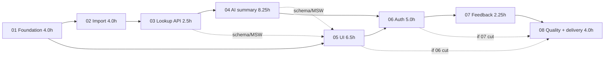

# Implementation plan

> Master plan for the Resolvvi technical challenge: a lawsuit lookup app with an LLM plain-language summary. Derived from the challenge statement, the data analysis and the Doity admin process. Living document: update it when scope, estimates or order change (see [finish-delivery-docs](../skills/finish-delivery-docs.md)).

> **Update 2026-10-08:** the owner requires development to finish in **4 hours** with parallel agents. The schedule, lanes, gates and cut line now live in [EXECUTION-PLAN-4H](EXECUTION-PLAN-4H.md); sections 5 and 6 below are superseded by it. Scope, risks and findings still apply. Owner answers: Q2 Gemini (key in `.env` as `GEMINI_API_KEY`), Q3 Compose v2 installed (v5.6.0), Q9 CSV is tracked (`.gitignore` updated). Other roles added: Security Engineer; the Frontend role now owns WCAG 2.2 AA.

## Deadline

| Item | Value |
|------|-------|
| Challenge email received at | **TO FILL (owner)** |
| Hard deadline (email + 48 h) | **TO FILL** |
| Target send time (deadline minus 8 h) | **TO FILL** |
| Rule | **No commits or pushes after the hard deadline** |

All times below are relative to **T0 = the email timestamp**. Convert once T0 is known.

## 1. Goal and success criteria

Deliver a private GitHub repository, a demo video (max 4 min) and an email to `ariel@resolvvi.com` and `tayllan@resolvvi.com`, with a working app that satisfies every item below.

| Challenge item | Delivered by | Tier |
|----------------|--------------|------|
| FR1 Import CSV into the DB | Spec 02 | P0 |
| FR2 Home with one field + Consultar | Spec 05 | P0 |
| FR3 Lawsuit page like the court page (data + movements) | Specs 03, 05 | P0 |
| FR4 LLM summary section | Specs 04, 05 | P0 |
| FR5 Max 3 paragraphs, plain language | Spec 04 | P0 |
| NFR1 Any language | Ruby + TypeScript | P0 |
| NFR2 >= 80% coverage | All specs (TDD), verified in 08 | P0 |
| NFR3 Relational DB | PostgreSQL | P0 |
| NFR4 README with run steps and technologies | Specs 01 (F-9), 08 (D-6) | P0 |
| NFR5 AGENTS.md | Done in planning; kept accurate | P0 |
| Diff 1 Rails | Spec 01 | P0 (built in) |
| Diff 2 React | Specs 01, 05 | P0 (built in) |
| Diff 3 GraphQL | Specs 01, 03 | P0 (built in) |
| Diff 4 Authentication | Spec 06 | P1 |
| Diff 5 Rate the summary | Spec 07 | P2 |
| Deliverables: private repo, video, email | Spec 08 | P0 |

## 2. Planning findings that shape the work

From analysis of `data/lawsuits_movements.csv` (details in [data-import](../domains/data-import.md)):

1. 100 lawsuits, 5,568 movements. All CNJ numbers are valid (mod 97) and from TJSP.
2. Rows are **not** grouped or sorted reliably (only 27 of 100 lawsuits are in date-descending order) -> store `source_row`, sort by date then `source_row` ([ADR-0005](../adr/0005-movement-ordering-and-idempotent-import.md)).
3. The challenge's example number `1002271-82.2025.8.26.0003` is **not in the CSV**. Demo and tests use `1001399-31.2023.8.26.0070`.
4. 1,312 movements have no content; decisions live in "Teor do ato" text under the title "Remetido ao DJE". Noise titles dominate (publications, certificates), so the prompt needs classification and budgeting, not a raw dump.
5. Movement contents contain lawyer names and OAB numbers -> stripped before the LLM ([AI-GUARDRAILS](../AI-GUARDRAILS.md)).
6. The CSV has fewer fields than e-SAJ (no class, subject, judge, status), so the UI shows only what exists.

## 3. Environment status (checked 2026-10-07)

| Item | Status | Action |
|------|--------|--------|
| Docker engine 29.1.3, usable without sudo | OK | - |
| `docker compose` v2 plugin | **Missing** (only legacy `docker-compose` 1.29.2) | Owner installs the Compose v2 plugin before F-3 |
| Host Ruby | 3.0.2 (too old for current Rails) | All Ruby runs in containers (Ruby 3.3 image) |
| Node | 22.23.1 | OK |
| `psql` client | Present | OK |
| `gh` CLI | **Not installed** | Optional; otherwise open PRs from the compare URL (see [create-pull-request](../skills/create-pull-request.md)) |
| Git remote | `origin` = `git@github.com:marcio-henrique/consulta-processo-juridico.git`; SSH auth verified | Confirm repo is **private** |
| LLM API key | Unknown | Owner decision (section 11); `fake` provider keeps everything working without one |
| `.gitignore` | Contains a single line `data/`, so the **CSV, the challenge statement and the saved e-SAJ page are not versioned** | Owner decision Q9. A fresh clone would have no CSV to import, which breaks the Docker mount, the real-data test and the "clean clone" check. Not changed by the planning work. |

## 4. Work breakdown

Estimates are focused hours of AI-assisted work (include writing tests first). They exclude sleep and waiting.

| # | Spec | Lead | Hours | Depends on | Tier |
|---|------|------|------:|------------|------|
| 01 | [project-foundation](../../.kiro/specs/01-project-foundation/tasks.md) | DevOps | 4.0 | - | P0 |
| 02 | [lawsuit-data-import](../../.kiro/specs/02-lawsuit-data-import/tasks.md) | Backend | 4.0 | 01 | P0 |
| 03 | [lawsuit-lookup-api](../../.kiro/specs/03-lawsuit-lookup-api/tasks.md) | Backend | 2.5 | 02 | P0 |
| 04 | [ai-lawsuit-summary](../../.kiro/specs/04-ai-lawsuit-summary/tasks.md) | AI | 8.25 | 02, 03 | P0 |
| 05 | [lawsuit-lookup-ui](../../.kiro/specs/05-lawsuit-lookup-ui/tasks.md) | Frontend | 6.5 | 01 (+03/04 schema, mockable) | P0 |
| 06 | [user-authentication](../../.kiro/specs/06-user-authentication/tasks.md) | Backend + Frontend | 5.0 | 03, 04, 05 | P1 |
| 07 | [summary-feedback](../../.kiro/specs/07-summary-feedback/tasks.md) | Backend + Frontend | 2.25 | 04, 06 | P2 |
| 08 | [quality-and-delivery](../../.kiro/specs/08-quality-and-delivery/tasks.md) | QA + DevOps | 4.0 | all done or cut | P0 |
| | **Total** | | **36.5** | | |

## 5. Schedule

### Mode A: two parallel tracks (recommended)

Two agent sessions (Backend/AI track and Frontend track) after spec 01. Hours are cumulative focused hours (W), not wall-clock.

| Window (W) | Backend / AI track | Frontend track | Gate at the end |
|-----------|--------------------|----------------|-----------------|
| 0-4 | Spec 01 (all F tasks, shared) | same | **M0** `docker compose up` works, CI green, gates verified |
| 4-8 | Spec 02 (I-1..I-9); AI: A-1 (provider choice) early | U-1, U-2, U-3 (needs only F-6/F-7); Legal Expert reviews glossary | **M1** CSV imported: 100 / 5,568 |
| 8-10.5 | Spec 03 (L-1..L-5) | U-4, U-5, U-6 against MSW mocks | **M2** `lawsuit` query live; schema dumped |
| 10.5-19 | Spec 04 (A-2..A-12) | U-7, U-8, U-9, U-10, U-11 | **M3 core complete**: FR1-FR5 work end to end with the real API |
| 19-22.5 | Spec 06 AU-1..AU-6, AU-10 | AU-7, AU-8, AU-9 | **M4** auth works; guard spec green |
| 22.5-24.5 | FB-1..FB-3, FB-5 | FB-4 | **M5** feedback works |
| 24.5-28.5 | Spec 08 (shared) | same | **M6** deliverable ready |
| 28.5-36.5 | **Contingency (8 h = about 30% of 28.5)** | | |

Critical path: 01 -> 02 -> 03 -> 04 -> 06 (backend part) -> 07 -> 08 = about 28.5 h.

### Mode B: single sequential session

Order: 01, 02, 03, 04, 05, 06, 07, 08 = 36.5 h plus contingency. Too tight for 48 h of wall-clock with rest, so apply the cut line (section 6) early. At minimum, M3 must be reached by about W 27.

### Wall-clock guard rails (relative to T0)

| Wall-clock | Must have |
|------------|-----------|
| T0 + 6 h | M0 done (foundation) |
| T0 + 14 h | M2 done (import + lookup API) |
| T0 + 26 h | **M3 core complete** (otherwise skip 06 and 07) |
| T0 + 34 h | M4 done (otherwise skip 07) |
| T0 + 38 h | Start spec 08 **regardless** of what is unfinished |
| T0 + 40 h | Email sent (target) |
| T0 + 48 h | Hard deadline: repository frozen |

## 6. Cut line

Decide at each guard rail. Cut in this order; never lower a quality gate instead.

1. Spec 07 feedback (Diff 5) -> cut first if M4 is not reached by T0 + 34 h.
2. Spec 06 authentication (Diff 4) -> skip if M3 is not reached by T0 + 26 h. If skipped: remove the `UNAUTHENTICATED` requirement from the guard, document in README, and drop spec 07 too (it needs users).
3. Within spec 05: U-10 polish beyond the keyboard/contrast basics.
4. Within spec 08: D-3 Playwright becomes a documented manual run; D-4 repeat review is skipped if the prompt did not change.
5. Within spec 04: no second provider adapter; fewer golden-set lawsuits (minimum 5).

Never cut: TDD, coverage gate, specs 01-05, README, secrets hygiene, the demo video, the email.

## 7. Phase detail

### Phase 0: Foundation (spec 01)
Goal: runnable skeleton, gates, CI. Exit: M0. Risks: Compose v2 missing, Rails/gem version drift (record versions in README).

### Phase 1: Data (spec 02)
Goal: trustworthy data in PostgreSQL. Exit: real-file test shows 100 / 5,568 / 0 skipped; re-run is a no-op. `CnjNumber` ready for reuse by the API and mirrored in the UI.

### Phase 2: Read API (spec 03)
Goal: one query returns everything the page needs, with typed errors, deterministic ordering and bounded cost. Exit: query-count test, pagination test, schema dumped.

### Phase 3: AI summary (spec 04) and UI (spec 05) in parallel
Goal: M3. Backend builds the pipeline offline-first (`fake` provider), then the real adapter. The UI builds against MSW mocks, then switches to the real API. Exit: manual end-to-end check with the real API and `fake`, then with a real key on the golden set; Legal Expert checklist passes.

### Phase 4: Auth (spec 06)
Goal: every operation behind a session. Exit: guard spec iterates all schema fields; cookie flags verified in the browser.

### Phase 5: Feedback (spec 07)
Goal: one vote per user per summary, readable report. Exit: vote persists across reload.

### Phase 6: Quality and delivery (spec 08)
Goal: evidence and submission. Exit: [prepare-delivery](../skills/prepare-delivery.md) fully ticked, email sent, repository frozen.

## 8. Quality plan

| Practice | How |
|----------|-----|
| TDD | Failing test first on every task ([write-tests-tdd](../skills/write-tests-tdd.md)); PR must show Red evidence |
| Coverage | Backend SimpleCov 80% (branch coverage on) and frontend 80/80/80/70 from day one (F-4, F-6); never lowered |
| Requirement coverage | Traceability table (D-2) |
| Reviews by role | Architect reviews each `design.md` and ADR; Legal Expert reviews classifier table, prompt and golden-set summaries; QA reviews tests and edge cases ([agents/qa-engineer](../agents/qa-engineer.md)) |
| Security | Guardrails, brakeman, bundler-audit, npm audit, secret scan, Origin/JSON checks, throttling |
| Privacy | Lawyer names/OAB stripped; no prompt or content logging |
| Docs | [finish-delivery-docs](../skills/finish-delivery-docs.md) after every spec |

## 9. Git workflow

- Branch per spec: `feat/NN-slug` (for example `feat/02-lawsuit-data-import`); small commits in English using Conventional Commits (`feat:`, `test:`, `fix:`, `docs:`, `chore:`, `refactor:`). Prefer commit pairs `test: ...` then `feat: ...` to show Red then Green.
- One PR per spec to `main` using the [PR template](../templates/pull-request-description.md); the owner merges. Without `gh`, use the GitHub compare URL.
- Tag milestones: `m0-foundation`, `m3-core-complete`, `m6-deliverable`.
- Everything before the hard deadline; after it, nothing.

## 10. Risks

| # | Risk | Likelihood | Impact | Mitigation |
|---|------|:---------:|:------:|------------|
| R1 | No LLM API key or provider outage during review | M | H | `fake` provider default; real key optional; README explains both; graceful `SUMMARY_UNAVAILABLE` UI |
| R2 | LLM output has legalese or invented facts | M | H | Classifier + cleaner + strict prompt; validator; golden-set review by Legal Expert; "not informed" rule |
| R3 | Prompt injection through movement text | L | M | Data-not-instructions rule; fenced data; validated plain-text output; injection fixture test |
| R4 | Compose v2 missing / Docker friction | H (known) | M | Owner installs plugin before F-3; fallback documented only if absolutely needed |
| R5 | Rails/gem/Node version surprises | M | M | Verify versions in F-1; pin lockfiles; Ruby 3.3 image |
| R6 | Coverage below 80% late | M | H | Gate from F-4; TDD; check at the end of each spec |
| R7 | Time overrun | M | H | Guard rails and cut line (sections 5-6); start spec 08 by T0 + 38 h regardless |
| R8 | Wrong ordering of same-day movements | M | L | `source_row` tie-break documented as an assumption; visible in README |
| R9 | N+1 or slow queries | L | M | Dataloader; query-count test |
| R10 | Concurrent summary requests double-bill | L | M | Advisory lock + unique index; concurrency test |
| R11 | Cookie auth misconfigured behind proxy | M | M | Same-origin via Vite proxy; verify flags in the browser; Origin check tests |
| R12 | Secrets committed | L | H | `.gitignore`, `.env.example`, CI secret scan, history scan before delivery |
| R13 | Demo uses the challenge's example number and shows "not found" | M | M | Documented; demo uses `1001399-31.2023.8.26.0070`; show the not-found state deliberately |
| R14 | Late commits after the deadline | L | H | Freeze task D-10; deadline written at the top of this file |
| R15 | Advisory lock holds a DB connection during the LLM call | L | L | Accepted at this scale (ADR-0003); Puma/DB pool sized for demo use |
| R16 | Reviewers clone the repo and the CSV is missing because `data/` is git-ignored | H (as configured today) | H | Resolve Q9 in F-2; clean-clone test in D-7 fails loudly if the CSV is absent; importer fails with a clear message |

## 11. Open questions for the owner

| # | Question | Needed by | Default if no answer |
|---|----------|-----------|----------------------|
| Q1 | Exact time the challenge email was received (T0)? | Now | Plan stays relative |
| Q2 | Which LLM provider and API key can be used for the real summaries? | A-1 (about W 4) | Build with `fake`, wire one real adapter after the key is available |
| Q3 | Install the Docker Compose v2 plugin (and optionally `gh`)? | F-3 | Cannot proceed with the documented Compose workflow |
| Q4 | Is the GitHub repository already private? Merge PRs yourself, or may agents commit directly to `main` for speed? | Before first push | PRs per spec, owner merges |
| Q5 | OK to send names of parties (not lawyers) that appear in movement text to the LLM provider? | A-5 | Allowed (public lawsuits), lawyers/OAB always stripped |
| Q6 | Should the home page also be reachable without login (only the form), or fully behind login? | AU-8 | Fully behind login |
| Q7 | A real lawyer available to confirm the glossary open questions? | A-3 / A-11 | Legal Expert agent drafts, limits documented |
| Q8 | UI copy tone: formal "você" or neutral? | U-4 | Neutral, short sentences |
| Q9 | The current `.gitignore` (`data/`) hides the CSV from git. May the CSV be committed so a fresh clone can import it? Recommended: replace the rule with `data/*` plus `!data/lawsuits_movements.csv`, keeping the statement and the saved e-SAJ page (third-party assets) untracked. | F-2 | Recommended option, applied in F-2 only after the owner confirms. Until then, README would have to tell reviewers to place the CSV in `data/`, which is fragile |

## 12. Backlog (explicitly out of scope for the delivery)

Scraping the live tribunal; other courts; password reset and email verification; roles; summary streaming; background jobs; regenerating summaries on demand by admins; search by party or lawyer; exporting data; dark mode; i18n beyond pt-BR; cloud deployment.

## 13. Ready-to-start checklist

- [x] Challenge statement read; data profiled
- [x] Harness written: AGENTS.md, CLAUDE.md, roles, skills, domain docs, ADRs, specs, steering
- [ ] T0 and deadlines filled in at the top of this file (Q1)
- [ ] Compose v2 plugin installed (Q3)
- [ ] LLM key decision (Q2)
- [ ] Repository privacy confirmed (Q4)
- [ ] Decision on committing the CSV / `.gitignore` rule (Q9)
- [ ] Start with spec 01, task F-1 ([start-feature](../skills/start-feature.md))

## 14. Change log

| Date | Change |
|------|--------|
| 2026-10-07 | Initial plan created with specs 01-08 and harness |
