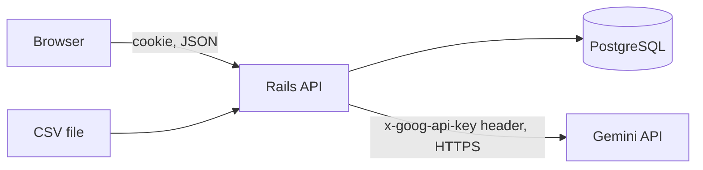

# Security

> Threat model and control matrix. Owner: Security Engineer agent ([role](agents/security-engineer.md)). Update the "Status" column as controls land; each row must name the test or command that proves it.

## 1. Assets and trust boundaries

| Asset | Why it matters |
|-------|----------------|
| `GEMINI_API_KEY` | Paid API; abuse costs money and leaks quota |
| User accounts and sessions | Email + password digest, session tokens |
| Lawsuit data | Public court data, but includes lawyer names/OAB and sometimes party names |
| Availability of `/graphql` | Expensive operations: DB pagination, LLM generation |

Boundaries: browser to API (untrusted client), API to Gemini (untrusted model output), CSV to importer (untrusted file content), movement text to prompt (untrusted text).

## 2. Control matrix

| # | Threat | Control | Where (spec task) | Proof | Status |
|---|--------|---------|-------------------|-------|--------|
| S1 | Secret committed | `.gitignore` ignores `.env*` except `.env.example`; CI secret scan; history scan before delivery | F-2, F-8, D-5 | `git check-ignore -v .env`; scan output | Done for `.gitignore` |
| S2 | Gemini key leaked to browser or logs | Key read only in the backend from ENV; sent in header `x-goog-api-key` (never in the URL); `filter_parameters` and no body logging; adapter spec asserts the key is absent from log output and error messages | A-7, SEC-2 | Adapter + log-capture specs | Done (A-7, SEC-2) |
| S3 | Credential stuffing | `rack-attack`: 5 sign-in attempts/min per IP and per email; generic error; bcrypt | AU-3, AU-6 | Throttle request spec | Done |
| S4 | User enumeration | Same message and comparable time for unknown email and wrong password | AU-3 | Request spec + dummy compare | Done |
| S5 | Session theft or fixation | Random 32-byte token, digest-only storage, new session on sign-in, `HttpOnly; SameSite=Lax; Secure` (prod), 14-day expiry, delete on sign-out | AU-1..AU-3 | Cookie-flag specs | Done |
| S6 | CSRF | JSON-only `POST`, `Origin` host check, `SameSite=Lax` | AU-5 | 403/415/405 specs | Done |
| S7 | Anonymous use of lookups/LLM | Schema-wide guard with allow-list (`signUp`, `signIn`, `me`) | AU-4 | Spec iterating all schema fields | Done |
| S8 | GraphQL abuse | Depth <= 10, complexity cap, max aliases, page size <= 100, introspection disabled in production | L-1, SEC-3 | Schema specs | Done |
| S9 | LLM cost abuse | Auth required, per-user 10/min throttle, DB cache by digest, advisory lock | A-9, AU-6 | Concurrency + throttle specs | Done |
| S10 | Prompt injection via movement text | System prompt says movement text is data; text fenced in the user prompt; output validated and rendered as plain text; injection fixture test | A-5, A-6 | Fixture spec | Planned |
| S11 | XSS | Text-only rendering of summary and movements; CSP `default-src 'self'; script-src 'self'; object-src 'none'; frame-ancestors 'none'; base-uri 'self'`; no inline scripts | SEC-1, U-7 | Header spec; component test with `` text | Done (API headers; SPA CSP for production is the host's job) |
| S12 | Clickjacking and sniffing | `X-Frame-Options: DENY` (or CSP frame-ancestors), `X-Content-Type-Options: nosniff`, `Referrer-Policy: same-origin`, HSTS in production | SEC-1 | Header spec | Done |
| S13 | PII to the LLM | Strip `Advogado(s):` lines and OAB patterns; prompt-level test | A-4, A-5 | Cleaner/builder specs | Planned |
| S14 | Malicious or malformed CSV | Parameterized inserts, per-row validation, field length caps, no dynamic code, transactions | I-4, I-5 | Importer specs | Planned |
| S15 | Information leakage in errors | `rescue_from` returns generic pt-BR message; production error pages without traces; request id logged | L-1 | Request spec | Done |
| S16 | Vulnerable dependencies | `bundler-audit`, `npm audit --omit=dev`, `brakeman` in CI; lockfiles | F-8, D-5 | CI output | Planned |
| S17 | Container hardening | Non-root runtime user; `.dockerignore` excludes `.env`, `.git`, `node_modules`; no secrets baked in images; DB port not published | F-3, SEC-4 | `docker compose config`, `docker run id` check | Done (verified: `id` in both containers is non-root, DB port unpublished, `.env` in `.dockerignore`) |
| S18 | Session cookie over HTTP in production | `Secure` flag and `force_ssl` in production env; documented that the demo runs on localhost | AU-3, D-6 | Production-env spec | Partial: cookie is `Secure` in production; TLS termination must come from the host (see section 5) |

## 3. Security headers (SEC-1)

Set in Rails via `config.action_dispatch.default_headers` and in the Vite dev server only where useful (the CSP for dev must allow the Vite HMR websocket, so enforce the strict CSP in production builds and test it with a production-like run).

## 4. Logging rules (SEC-2)

- `Rails.application.config.filter_parameters += [:password, :token, :authorization, :secret, :cookie, :variables, /api[-_]?key/i, /session/i]`.
- GraphQL `variables` are filtered because sign-in carries passwords in variables.
- Never log: prompt text, movement content, summary text, `Authorization`/`x-goog-api-key` headers, cookies.
- Log: request id, operation name, user id, cache hit/miss, provider, model, latency, token counts.

## 5. Exceptions register

Record every deliberately skipped control here with date, reason and owner approval.

| Date | Control | Reason | Approved by |
|------|---------|--------|-------------|
| 2026-10-09 | `force_ssl` / `assume_ssl` left off in production | The demo runs on `http://localhost` through Docker; forcing TLS would break it. HSTS is sent in production and the cookie is `Secure` there, so a real deployment only needs TLS in front. | Project owner (spec 06) |

## 6. Residual risks accepted for this delivery

- No password reset or email verification (accounts are low value).
- No MFA.
- Synchronous LLM calls can hold a Puma thread for up to the total deadline (about 45 s); mitigated by throttling.
- Party names present in movement text may be sent to Gemini (public lawsuits; owner decision Q5 in the plan).
